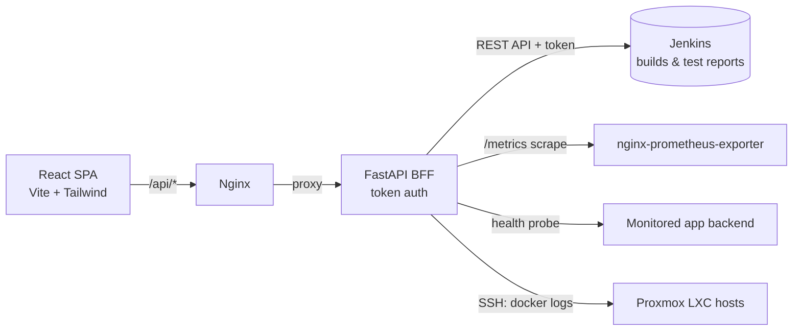

# QA Observability Dashboard

[](https://github.com/fanfanmyid/QA-Observability-Dashboard/actions/workflows/ci.yml)


A single-pane-of-glass observability dashboard for QA infrastructure: it aggregates **Jenkins pipeline status, test-suite results, service health, and filtered container logs** from a self-hosted environment into one authenticated React dashboard.

Built as the monitoring layer of a self-hosted quality platform (Proxmox LXC + Jenkins + Tailscale), following a **Backend-for-Frontend (BFF)** pattern — the browser never talks to Jenkins or SSH hosts directly; all credentials stay server-side.

## Why this exists

QA teams running self-hosted CI typically juggle four tabs: Jenkins build status, test reports, health endpoints, and `ssh + docker logs` when something breaks. This dashboard collapses that loop into one screen, so the mean time from "pipeline is red" to "here is the relevant log line" drops from minutes to seconds.

## Architecture



| Layer | Tech | Role |
|---|---|---|
| Frontend | React (Vite), Tailwind CSS, Lucide icons | Login + protected dashboard, polling views |
| BFF API | Python 3.11, FastAPI, httpx, asyncssh | Aggregation, auth, credential isolation |
| Serving | Nginx (frontend container) | Serves SPA, proxies `/api/*` to backend (no CORS) |
| Delivery | Docker Compose, Jenkins pipeline | Containerized deploy to Proxmox LXC over SSH |

### API surface

| Endpoint | Auth | Purpose |
|---|---|---|
| `POST /api/login` | password | Issues bearer token (fail-closed: unset password/token env ⇒ login disabled) |
| `GET /api/qa/pipeline` | bearer | Last build status/duration/number for backend & frontend Jenkins jobs (fetched concurrently) |
| `GET /api/qa/tests` | bearer | Pass/fail/skip counts from Jenkins `testReport` API |
| `GET /api/qa/health` | bearer | nginx exporter `nginx_connections_active` + app health probe |
| `GET /api/qa/logs?service=backend\|frontend` | bearer | Last 50 log lines over SSH, with health/metrics probe noise filtered out server-side |

### Security notes

- All integration credentials (Jenkins API token, SSH key) live only in server-side env/`.env` — never shipped to the browser.
- Auth is fail-closed: empty `QA_DASHBOARD_PASSWORD` or `CRED_TOKEN` rejects every login.
- Container names are shell-quoted before being interpolated into remote `docker logs` commands (injection-safe).
- Intended to run inside a private network (e.g. Tailscale); it is not hardened for direct public exposure. Use a read-only Jenkins user and a dedicated low-privilege SSH account.

## Running locally

```bash
cp .env.example .env    # fill in QA_DASHBOARD_PASSWORD + CRED_TOKEN at minimum
docker compose up -d --build
```

Open **http://localhost:4000** and log in with `QA_DASHBOARD_PASSWORD`.
The API is also exposed directly on `http://localhost:8001` (Swagger at `/docs`).

Without Jenkins/SSH env values configured the dashboard still runs — panels degrade gracefully to `UNKNOWN`/empty states instead of crashing.

## CI/CD

- **GitHub Actions** (`.github/workflows/ci.yml`): backend import/lint checks + API smoke tests against a live uvicorn instance, frontend production build.
- **Jenkins** (`Jenkinsfile`): production delivery — package artifact → inject `.env` from Jenkins Credentials → deploy over SSH to the monitoring LXC → `docker compose up -d --build` → HTTP smoke gate that fails the pipeline if the SPA doesn't return 200.

## Author

**Muhammad Fandly Fadlurachman** — Senior QA Automation Engineer
[GitHub](https://github.com/fanfanmyid) · [Portfolio](https://fanfan.my.id)
